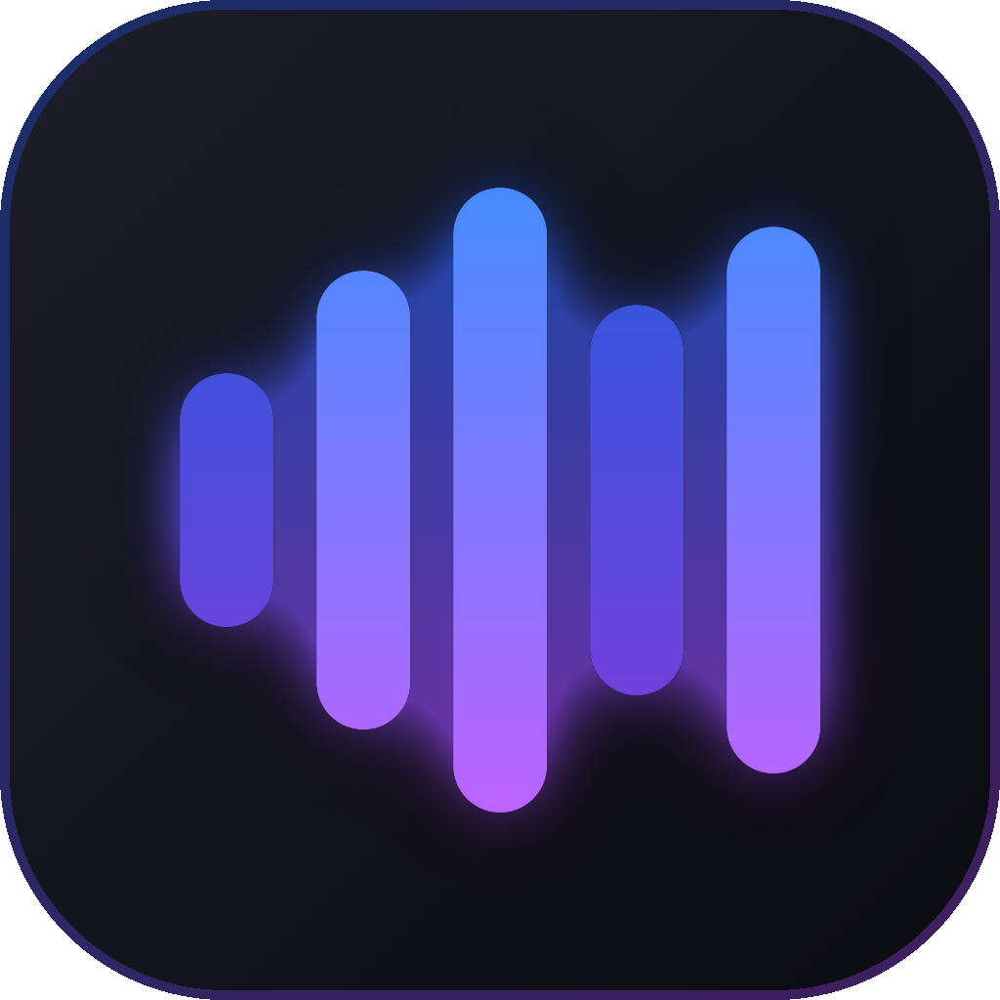

<p align="center"><a href="README.md">English</a> · <a href="README.zh-CN.md">简体中文</a> · <strong>Bahasa Indonesia</strong></p>

<p align="center">
  
</p>

<h1 align="center">MyMusic</h1>

<p align="center"><strong>Satu pemutar untuk YouTube Music dan Spotify.</strong></p>

<p align="center">Klien YouTube Music dan Spotify untuk macOS, Windows, dan Linux. YouTube Music bisa dipakai tanpa akun. Satu pencarian, satu antrean, playlist campuran, lirik tersinkron, tema, dan plugin.</p>

<p align="center"><sub>Ini terjemahan dari <a href="README.md">README berbahasa Inggris</a>. Jika ada perbedaan, yang terbaru adalah versi bahasa Inggris.</sub></p>

<p align="center">
  <a href="https://github.com/bigdaddy284/mymusic/actions/workflows/ci.yml"></a>
  <a href="https://github.com/bigdaddy284/mymusic/actions/workflows/pages.yml"></a>
  <a href="https://github.com/bigdaddy284/mymusic/releases/latest"></a>
  <a href="https://github.com/bigdaddy284/mymusic/releases"></a>
  <a href="https://pkg.go.dev/github.com/bigdaddy284/mymusic"></a>
  <a href="go.mod"></a>
  
  <a href="#lisensi"></a>
</p>

<p align="center">
  <a href="https://bigdaddy284.github.io/mymusic/">Situs web</a> ·
  <a href="https://github.com/bigdaddy284/mymusic/releases/latest">Unduh</a> ·
  <a href="https://bigdaddy284.github.io/mymusic/docs/">Dokumentasi</a> ·
  <a href="CHANGELOG.md">Catatan perubahan</a>
</p>

<p align="center">
  
</p>

## Mengapa MyMusic

Jika musik Anda terbagi antara YouTube Music dan Spotify, biasanya Anda
perlu dua aplikasi, dengan dua pencarian, dua antrean, dan dua pustaka.
MyMusic menyatukan kedua layanan itu dalam satu pemutar:

- **Satu pencarian.** MyMusic mencari di YouTube Music dan Spotify
  sekaligus, dan menandai setiap hasil dengan layanan asalnya.
- **Satu antrean dan satu pustaka.** Lagu Spotify bisa diputar tepat setelah
  lagu YouTube Music, dan satu playlist bisa berisi lagu dari keduanya.
- **Tidak perlu akun.** YouTube Music langsung bisa diputar begitu aplikasi
  dibuka. Masuk ke akun hanya jika Anda ingin memakai pustaka Anda sendiri.
  Spotify bersifat opsional.
- **Program kecil.** MyMusic adalah satu program Go yang menggambar
  jendelanya sendiri di GPU. Tidak ada browser di dalamnya yang harus
  diunduh atau ditampung di memori.
- **Bebas diubah.** Ada sepuluh tema bawaan, komunitas menambahkan tema dan
  plugin lainnya, dan setiap perintah bisa diberi tombol pilihan Anda
  sendiri.
- **Privat.** MyMusic tidak punya akun, server, analitik, atau telemetri
  sendiri.
- **Gratis dan open source,** di bawah lisensi MIT atau GPL 3.0.

## Fitur

### Cari dan putar

- **Satu pencarian untuk kedua layanan.** Hasil dari YouTube Music dan
  Spotify tampil berdampingan, masing-masing ditandai dengan layanannya.
  Hasil YouTube Music menunjukkan berapa kali setiap lagu diputar, sehingga
  versi aslinya mudah dibedakan dari versi cover.
- **Satu antrean.** Campur lagu dari kedua layanan, acak dan ulangi
  semuanya sekaligus, dan biarkan radio melanjutkan saat antrean habis.
- **Explore (Jelajahi).** Rilis baru, lagu yang sedang tren, tangga lagu,
  mood dan genre, serta lagu yang terkait dengan lagu yang sedang diputar.
- **Lirik tersinkron** yang mengikuti lagu, atau teks biasa jika Anda lebih
  suka.
- **Pemutar mini** yang tetap berada di atas jendela-jendela lain.

### Pustaka Anda

- **Mix:** playlist yang berisi lagu dari semua layanan. Impor playlist dari
  sebuah layanan ke dalam mix, lalu cari dan urutkan lagu di dalam mix mana
  pun.
- **Lagu yang disukai** dari kedua layanan dalam satu daftar.
- **Riwayat dan statistik mendengarkan,** dari hari ke hari.
- **Akun Anda.** Masuk ke YouTube Music lewat halaman milik Google sendiri
  untuk mendapatkan feed beranda, lagu yang disukai, playlist, album, dan
  artis Anda, baik sebagai akun Anda maupun salah satu channel brand milik
  akun itu. Masuk ke Spotify untuk memakai pustaka Anda di sana. Lagu yang
  Anda sukai, album dan playlist yang Anda simpan, serta artis yang Anda
  ikuti juga tercatat di layanan tersebut. Lagu yang Anda putar masuk ke
  riwayat YouTube Music Anda, yang menjadi dasar rekomendasinya.

### Tiga cara memutar Spotify

- **Langsung di MyMusic,** dengan kualitas Spotify, tanpa membuka aplikasi
  Spotify (Premium, di Windows dan macOS).
- **Lewat Spotify Connect:** di aplikasi Spotify, ponsel, atau speaker Anda.
- **Dari YouTube Music:** MyMusic memutar rekaman lagu Spotify tersebut yang
  ada di YouTube Music, yang bisa diputar tanpa Premium.

### Suara

- Crossfade, kenyaringan yang setara antarlagu, dan perataan volume.
- Equalizer sepuluh band dengan preset.
- Visualizer.
- Cache offline untuk lagu-lagu yang pernah Anda putar.

### Di desktop Anda

- Tombol media dan kontrol media sistem di Windows, macOS, dan Linux.
- Tombol pemutar di thumbnail taskbar Windows.
- Kontrol di tray, notifikasi setiap kali lagu baru diputar, dan berjalan
  otomatis saat login.
- Tautan `mymusic://`.
- **Last.fm:** setiap lagu yang Anda dengar tercatat di profil Anda, dan
  scrobble yang dibuat saat offline dikirim begitu Anda kembali online.
- **Discord:** profil Anda menampilkan lagu yang sedang diputar, lengkap
  dengan sampul dan sisa waktunya.
- **Pembaruan:** MyMusic memeriksa rilis baru saat dibuka dan setiap
  beberapa jam, memeriksa tanda tangan digitalnya, lalu memasangnya saat
  Anda memintanya, atau secara otomatis jika Anda memilih opsi itu.

### Sesuaikan sesuka Anda

- **Tema.** Sepuluh tema bawaan dengan efek yang bisa diatur, satu tema
  untuk mode terang dan satu untuk mode gelap, serta warna aksen pilihan
  Anda sendiri atau yang diambil dari sampul lagu yang sedang diputar.
- **Tema dan plugin komunitas,** cukup sekali klik di marketplace.
- **Plugin** menambahkan halaman, perintah, aksi lagu, dan widget lewat API
  bertipe, dan semuanya tampil dengan tema Anda.
- **Mengutamakan keyboard.** Pintasan untuk semua hal yang umum, tombol
  pilihan Anda sendiri untuk perintah apa pun (termasuk perintah dari
  plugin), dan palet perintah (<kbd>Ctrl</kbd> <kbd>K</kbd>) untuk sisanya.
- **File pengaturan.** Pengaturan Anda tersimpan sebagai `settings.json` di
  folder data Anda (`%AppData%\MyMusic` di Windows,
  `~/Library/Application Support/MyMusic` di macOS, `~/.config/MyMusic` di
  Linux), jadi bisa Anda simpan bersama dotfiles Anda. Simpan file itu saat
  MyMusic berjalan, dan perubahannya langsung berlaku; file ini bisa dibuka
  lewat Settings › Desktop › Settings file (Pengaturan › Desktop › File
  pengaturan).

## Sekilas tampilan

<p align="center">
  
</p>

<p align="center"><sub><b>Dengarkan.</b> Di tengah, アイドル oleh YOASOBI sedang diputar: setiap baris menyala saat dinyanyikan, dengan romaji dan terjemahan di bawahnya. Di kiri, sebuah album; di kanan, podcast yang Anda ikuti.</sub></p>

<p align="center">
  
</p>

<p align="center"><sub><b>Sesuaikan sesuka Anda.</b> Di tengah, keempat tata letak: Blend, yang bawaan, Expressive, Crate, dan Tiles, di atas tema-temanya. Di kiri, tema Material yang mengambil warnanya dari sampul lagu yang diputar. Di kanan, tema komunitas di marketplace.</sub></p>

## Pemasangan

Unduh file untuk sistem Anda dari
[rilis terbaru](https://github.com/bigdaddy284/mymusic/releases/latest):

| Sistem | Unduhan |
|---|---|
| macOS 12 dan yang lebih baru (Apple silicon dan Intel) | [`mymusic-<version>-macos-universal.dmg`](https://github.com/bigdaddy284/mymusic/releases/latest) |
| Windows 10 dan 11 (x64, Arm), installer | [`mymusic-<version>-windows-<arch>-setup.exe`](https://github.com/bigdaddy284/mymusic/releases/latest) |
| Windows, portabel, tanpa instalasi | [`mymusic-<version>-windows-<arch>-portable.zip`](https://github.com/bigdaddy284/mymusic/releases/latest) |
| Debian, Ubuntu, dan turunannya | [`mymusic-<version>-linux-<arch>.deb`](https://github.com/bigdaddy284/mymusic/releases/latest) |
| Fedora, openSUSE, dan turunannya | [`mymusic-<version>-linux-<arch>.rpm`](https://github.com/bigdaddy284/mymusic/releases/latest) |
| Linux apa saja, satu file | [`mymusic-<version>-linux-<arch>.AppImage`](https://github.com/bigdaddy284/mymusic/releases/latest) |
| Linux apa saja, dalam sandbox (Flatpak) | [`mymusic-<version>-linux-<arch>.flatpak`](https://github.com/bigdaddy284/mymusic/releases/latest) |
| Linux apa saja, di folder home Anda | [`mymusic-<version>-linux-<arch>.tar.gz`](https://github.com/bigdaddy284/mymusic/releases/latest), beserta `install.sh` |

`<arch>` adalah `amd64` untuk x64 dan `arm64` untuk Arm. Setiap rilis
menyertakan `SHA256SUMS` untuk memeriksa file yang Anda unduh. Anda tidak
perlu file bernama `update-…`, `….delta`, `mymusic-<version>-macos-…`, atau
`-windows-<arch>.tar.gz`: file-file itu dipakai aplikasi yang sudah
terpasang untuk memperbarui dirinya.

Installer, zip portabel, dan arsip Linux bisa memperbarui dirinya sendiri.
`.deb`, `.rpm`, AppImage, dan Flatpak tidak bisa menimpa file instalasinya
sendiri, jadi MyMusic akan memberi tahu Anda saat versi baru tersedia dan
mengunduhkannya untuk Anda. Untuk zip portabel, ekstrak di mana saja lalu
buka `MyMusic.exe`. Untuk AppImage, jadikan file itu bisa dijalankan
(`chmod +x`) lalu buka. Untuk Flatpak, buka dengan pusat perangkat lunak
(software center) Anda, atau jalankan
`flatpak install ./mymusic-<version>-linux-<arch>.flatpak`; saat pertama
kali, Flatpak akan mengambil runtime GNOME dari Flathub.

### Pertama kali dijalankan

- **macOS:** aplikasi ini belum dinotarisasi oleh Apple, jadi saat pertama
  kali Anda membukanya, macOS akan memberi tahu bahwa aplikasi ini tidak bisa
  diperiksa. Tetap buka aplikasinya lewat
  System Settings › Privacy & Security › Open Anyway (Pengaturan Sistem ›
  Privasi & Keamanan › Tetap Buka), atau jalankan perintah ini sekali di
  Terminal:

  ```sh
  xattr -dr com.apple.quarantine /Applications/MyMusic.app
  ```
- **Windows:** installer ini belum ditandatangani, jadi SmartScreen mungkin
  memberi peringatan: pilih More info (Info selengkapnya), lalu Run anyway
  (Tetap jalankan). Masuk ke YouTube Music dan memutar Spotify di MyMusic
  memerlukan WebView2 Runtime, yang sudah ada di Windows 11.
- **Linux:** MyMusic memerlukan GTK 3, serta PulseAudio (PipeWire juga
  menyediakannya) atau ALSA. Masuk ke YouTube Music memerlukan WebKitGTK
  4.1, ikon tray memerlukan `libayatana-appindicator3`, dan menyimpan data
  login Anda di keyring sistem memerlukan `libsecret`. `.deb` dan `.rpm`
  sudah memasang semuanya, dan Flatpak membawanya sendiri; untuk AppImage
  dan arsip:

  ```sh
  # Debian and Ubuntu
  sudo apt install libgtk-3-0 libpulse0 libwebkit2gtk-4.1-0 libayatana-appindicator3-1 libsecret-1-0
  # Fedora
  sudo dnf install gtk3 pulseaudio-libs webkit2gtk4.1 libayatana-appindicator-gtk3 libsecret
  ```
- **Semua sistem:** MyMusic menemukan sendiri audio sebagian besar lagu
  YouTube Music. Untuk sisanya, seperti lagu yang dibuat untuk anak-anak,
  MyMusic memakai [yt-dlp](https://github.com/yt-dlp/yt-dlp), yang
  dipasang MyMusic untuk Anda dari Settings › Playback (Pengaturan ›
  Pemutaran) dan selalu diperbaruinya. yt-dlp memerlukan runtime
  JavaScript: [Deno](https://deno.com), Node.js, Bun, atau QuickJS. Flatpak
  sudah menyertakan Node.js.

### Flatpak

Flatpak menjalankan MyMusic di dalam sandbox, yang bisa melihat jaringan,
server suara, layar, dan GPU, tetapi sama sekali tidak bisa melihat folder
home Anda. MyMusic menyimpan pengaturan dan pustakanya di
`~/.var/app/io.github.bigdaddy284.mymusic`, terpisah dari instalasi `.deb`,
`.rpm`, AppImage, atau arsip, dan keduanya bisa berjalan bersamaan. Untuk
memindahkan pengaturan dan pustaka dari instalasi lain, tutup keduanya,
salin `settings.json`, `library.json`, `queue.json`, dan folder `addons`
dari `~/.config/MyMusic` ke
`~/.var/app/io.github.bigdaddy284.mymusic/config/MyMusic`, lalu masuk lagi ke
akun-akun Anda: data login tetap tersimpan di keyring instalasi yang lain.

Di Flatpak, fitur berjalan otomatis saat login diatur lewat desktop Anda,
yang mungkin akan meminta izin Anda terlebih dahulu, dan yt-dlp milik Anda
sendiri harus berada di `~/.var/app/io.github.bigdaddy284.mymusic`, karena
sandbox tidak bisa melihat folder lain. Aplikasi Discord yang bukan Flatpak
hanya menampilkan lagu yang sedang diputar jika Discord sudah berjalan saat
MyMusic dibuka, dan hanya sampai Discord dimulai ulang; Discord versi
Flatpak tetap berfungsi, apa pun urutannya. Versi Flatpak ini masih baru:
ceritakan kepada kami lewat [issue](https://github.com/bigdaddy284/mymusic/issues)
bagaimana Flatpak berjalan di desktop Anda.

### Akun (semuanya opsional)

- **YouTube Music:** pilih Sign in to YouTube Music (Masuk ke YouTube Music)
  di Settings › Accounts (Pengaturan › Akun), lalu masuk ke Google di jendela
  yang terbuka. Apa yang Anda ketik hanya dikirim ke Google. MyMusic
  menyimpan sesi itu dalam keadaan terenkripsi, dengan kunci di keyring
  sistem Anda jika tersedia.
- **Spotify:** Spotify hanya mengizinkan sebuah aplikasi melayani paling
  banyak lima pengguna, dan hanya selama pemiliknya berlangganan Premium,
  jadi Anda masuk dengan aplikasi Spotify buatan Anda sendiri. Hanya butuh
  dua menit: [docs/spotify.md](docs/spotify.md) memandu Anda langkah demi
  langkah.
- **Last.fm:** buat akun API di
  [last.fm/api/account/create](https://www.last.fm/api/account/create)
  (nama apa saja, tanpa callback URL), tempelkan API key dan shared secret
  dari akun itu di Settings › Accounts, lalu setujui MyMusic di browser
  Anda.
- **Discord:** selama aplikasi Discord berjalan, profil Anda menampilkan apa
  yang sedang Anda dengarkan. Matikan di Settings › Desktop (Pengaturan ›
  Desktop).

Ada yang tidak berfungsi? [docs/troubleshooting.md](docs/troubleshooting.md)
membahas masalah yang umum terjadi dan masalah yang sudah diketahui.

## Membangun dari kode sumber

Anda memerlukan [Go](https://go.dev/dl/) 1.27.3 atau yang lebih baru,
[Bun](https://bun.sh) 1.2 atau yang lebih baru, yang menjalankan CLI MyGo,
dan Git. MyGo tidak memerlukan compiler C, jadi sistem apa pun bisa
membangun MyMusic untuk semua sistem.

### Windows

```powershell
winget install GoLang.Go
winget install Oven-sh.Bun
winget install Git.Git
```

Buka terminal baru, lalu:

```powershell
git clone https://github.com/bigdaddy284/mymusic
cd mymusic
bun install
bun run dev
```

Fitur masuk akun dan pemutaran Spotify memerlukan WebView2 Runtime, yang
sudah ada di Windows 11. Di Windows 10, pasang dari
[Microsoft](https://developer.microsoft.com/microsoft-edge/webview2/).

### macOS

Dengan [Homebrew](https://brew.sh):

```sh
brew install go oven-sh/bun/bun
git clone https://github.com/bigdaddy284/mymusic
cd mymusic
bun install
bun run dev
```

### Linux

Pasang Go dari [go.dev/dl](https://go.dev/dl/) (paket dari distribusi
sering kali lebih lama dari 1.27.3), lalu Bun dan library yang dipakai
MyMusic untuk berjalan:

```sh
curl -fsSL https://bun.sh/install | bash
# Debian and Ubuntu
sudo apt install git libgtk-3-0 libpulse0 libwebkit2gtk-4.1-0 libayatana-appindicator3-1 libsecret-1-0
# Fedora
sudo dnf install git gtk3 pulseaudio-libs webkit2gtk4.1 libayatana-appindicator-gtk3 libsecret
```

Kemudian:

```sh
git clone https://github.com/bigdaddy284/mymusic
cd mymusic
bun install
bun run dev
```

### Nix

Dengan [Nix](https://nixos.org), `nix develop` menyediakan alat-alat yang
dipakai untuk membangun rilis, pada versi yang dikunci oleh `flake.lock`:
Go, Bun, NSIS, GoReleaser, dan Zola. `nix build` membangun MyMusic untuk
Linux dari kode sumber, ke dalam `result/`.

### Pengembangan

`bun run dev` membangun aplikasi, menjalankannya, dan membangunnya ulang
setiap kali Anda mengedit kode. Datanya terpisah dari MyMusic yang
terpasang, dengan nama `MyMusic Dev`.

```sh
bun run build:plugins          # the plugins' JavaScript, from their TypeScript
go test ./...                  # the app's tests
bun run typecheck              # the plugin SDK and the community's plugins
go run ./tools/registry -check # the community registry
bun run build                  # the packaged app for this system, in build/
bun run build -- -platform windows/amd64,windows/arm64
```

Di shell Nix, buat file unduhan Windows dengan
`.github/scripts/build.sh windows/amd64,windows/arm64`, seperti saat membuat
rilis.

[Situs web](https://bigdaddy284.github.io/mymusic/) ada di `site/`, dibangun
dengan [Zola](https://www.getzola.org), dan panduan di `docs/` menjadi
halaman `/docs/` di situs itu. `go run ./tools/sitedocs && zola --root site serve`
menampilkan pratinjaunya. Rilis dibangun di shell Nix dan diterbitkan oleh
[GoReleaser](https://goreleaser.com) (`.goreleaser.yaml`).

[docs/architecture](docs/architecture/README.md) menjelaskan bagaimana
bagian-bagiannya saling terhubung.

### Struktur kode

Aplikasinya ada di package root, dengan package-package di `internal/` di
bawahnya. Package di luar `internal/` boleh diimpor oleh siapa saja, dan
didokumentasikan di [pkg.go.dev](https://pkg.go.dev/github.com/bigdaddy284/mymusic).

```
*.go                 the app and its windows: the pages, the player bar, the
                     mini player, the tray, media keys, deep links
fonts/               the typefaces the windows draw with
internal/app         the services the windows call, and the desktop integration
internal/player      the queue, played by the audio engine or on Spotify's devices
internal/audio       MyMusic's audio engine, and the system's audio output
internal/plugins     plugins, each in a JavaScript engine of its own
internal/youtube     YouTube Music's catalog, and your account there
internal/spotify     the Spotify Web API, its sign-in and Spotify Connect
internal/stream      audio streams, from YouTube or yt-dlp, opened for the engine
internal/match       Spotify tracks matched to their YouTube Music recordings
internal/library     liked songs, mixes, history and stats
internal/lastfm      scrobbling to Last.fm
internal/discord     what plays, on your Discord profile
internal/diag        the log, without secrets, and the reports of crashes
internal/addons      themes and plugins, and the community registry
builtin/themes       the themes MyMusic ships with
public/              the page of Spotify's player, on Windows
sdk/                 the types of the plugin API
community/           community themes and plugins, and their registry
```

Package yang bisa Anda impor:

```
opus/                an Opus decoder in pure Go, a port of libopus's
aac/                 an AAC-LC decoder in pure Go
webm/                the audio of WebM files: packets, times and seeking
mp4/                 the audio of MP4 files: packets, times and seeking
resample/            sample rate conversion, with Kaiser-windowed sincs
lyrics/              synced lyrics from LRCLIB, and the LRC format
brand/               MyMusic's logo, for code that draws it
```

## Komunitas

Siapa pun bisa memasang tema dan plugin komunitas dari marketplace (ikon
toko di sidebar), dan Anda juga bisa menambahkan karya Anda sendiri.

### Membuat tema

Tema adalah file `theme.json` yang mengatur warna, font, dan bentuk sudut.
[docs/themes.md](docs/themes.md) mencantumkan setiap token dan memberi
contoh tema yang lengkap. Untuk mencoba tema Anda, letakkan foldernya di
folder tema, yang bisa dibuka lewat Settings › Appearance › open themes
folder (Pengaturan › Tampilan › buka folder tema), lalu pilih tema itu di
Settings › Appearance.

### Membuat plugin

Plugin adalah modul kecil, ditulis dalam TypeScript atau JavaScript, yang
menambahkan halaman, perintah, aksi lagu, dan widget.
[docs/plugins.md](docs/plugins.md) mendokumentasikan API-nya, beserta
[definisi tipenya](sdk/index.d.ts) untuk editor Anda. Plugin komunitas
[sleep timer](community/plugins/sleep-timer) dan
[spectrum](community/plugins/spectrum) adalah contoh yang benar-benar
berfungsi.

### Bagikan

1. Fork repositori ini.
2. Tambahkan satu folder: `community/themes/<id>/` untuk tema, atau
   `community/plugins/<id>/` untuk plugin, lengkap dengan `plugin.json` dan
   `index.ts`.
3. Jalankan `bun run build:plugins`, `go run ./tools/registry`, dan
   `go run ./tools/registry -check`.
4. Buka pull request.

Setelah digabungkan, CI akan menerbitkannya ke
[branch registry](https://github.com/bigdaddy284/mymusic/tree/registry), dan
karya Anda akan muncul di marketplace semua orang. Detailnya ada di
[community/README.md](community/README.md).

## Privasi

MyMusic tidak punya akun, server, analitik, atau telemetri sendiri.
MyMusic berkomunikasi dengan:

- **YouTube dan Google:** katalog YouTube Music, stream audionya, dan
  tingkat kenyaringan setiap lagu, yang diminta tanpa login, serta gambar
  sampul; sebagian stream lewat yt-dlp. Jika Anda masuk: pustaka Anda di
  sana, dan lagu yang Anda putar, yang masuk ke riwayat YouTube Music Anda,
  kecuali Anda mematikannya di Settings › Accounts (Pengaturan › Akun).
- **Spotify,** setelah Anda masuk: pustaka Anda, perangkat Spotify Connect
  Anda, dan pemutar Spotify, yang dimuat dari `sdk.scdn.co` saat Spotify
  diputar di MyMusic.
- **LRCLIB:** judul, artis, album, dan durasi lagu yang sedang diputar,
  untuk mencari liriknya.
- **GitHub:** pemeriksaan versi baru saat aplikasi dibuka dan setiap
  beberapa jam, yang bisa Anda matikan di Settings › About (Pengaturan ›
  Tentang); registry komunitas saat Anda membuka marketplace; dan unduhan
  yt-dlp.
- **Last.fm,** setelah Anda menghubungkannya: lagu yang Anda putar.
- **Discord,** kecuali Anda mematikannya: lagu yang sedang diputar, dikirim
  ke aplikasi Discord di komputer Anda, yang kemudian menampilkannya di
  profil Anda.

Yang disimpan MyMusic di komputer Anda:

- Pengaturan dan pustaka Anda (lagu yang disukai, mix, riwayat, dan
  pencarian terakhir), di folder yang disebutkan di Settings › About.
- Lagu yang pernah Anda putar, di cache, sebanyak yang Anda izinkan di
  Settings › Playback (Pengaturan › Pemutaran), beserta tingkat
  kenyaringannya menurut pengukuran YouTube.
- Sampul yang pernah Anda lihat, hingga 256 MB.
- Data login Anda, termasuk sesi YouTube Music, di keyring sistem. Di
  Windows, jika Credential Manager (Manajer Kredensial) tidak bisa
  menyimpannya, data itu disimpan di file yang dienkripsi untuk akun Windows
  Anda; di Linux tanpa keyring, di file yang hanya bisa dibaca oleh pengguna
  Anda.
- Log, tanpa data login Anda.

Halaman riwayat di pustaka bisa menghapus daftar lagu yang pernah Anda
putar, Settings › Playback bisa menghapus cache dan sampul, dan keluar dari
sebuah layanan akan menghapus data login layanan tersebut.

Di Windows, visualizer mendengarkan audio Spotify yang diputar di komputer
ini, baik di MyMusic maupun di aplikasi Spotify, lewat process loopback
Windows, yang hanya mendengar aplikasi itu saja. Visualizer menganalisis
audio itu di memori dan tidak pernah merekam atau mengirimkannya.

## Kredit

MyMusic dibangun di atas proyek-proyek berikut:

- **[MyGo](https://github.com/egoist/mygo)**, framework desktop yang dipakai
  untuk membangun MyMusic. MyMusic memakai UI native MyGo: MyGo menggambar
  sendiri setiap jendela, dengan Go, tanpa webview, mulai dari halaman dan
  bilah pemutar hingga pemutar mini. CLI MyGo mengemas aplikasi ini,
  lengkap dengan installer dan pembaruan bertanda tangan yang dipakai
  aplikasi untuk memperbarui dirinya.
- **[Go](https://go.dev)**, bahasa pemrograman aplikasi ini, bersama
  [purego](https://github.com/ebitengine/purego), yang memanggil library
  sistem tanpa cgo, serta [golang.org/x/image](https://pkg.go.dev/golang.org/x/image)
  dan [golang.org/x/text](https://pkg.go.dev/golang.org/x/text).
- **[Sobek](https://github.com/grafana/sobek)**, mesin JavaScript tempat
  setiap plugin berjalan.
- **[Nix](https://nixos.org)**, yang mengunci versi alat-alat untuk
  membangun rilis, dan membangun MyMusic untuk Linux dari kode sumber.
- **[GoReleaser](https://goreleaser.com)**, yang menerbitkan rilis, dan
  [nFPM](https://nfpm.goreleaser.com) miliknya, yang membuat paket RPM.
- **[Bun](https://bun.sh)**, yang menjalankan proses build, dan
  **[TypeScript](https://www.typescriptlang.org)**, yang mengompilasi plugin
  dan memeriksa tipe pada SDK plugin.
- **[Zola](https://www.getzola.org)**, yang membangun situs web.
- **[NSIS](https://nsis.sourceforge.io)**, yang membuat installer Windows,
  dan [appimagetool](https://github.com/AppImage/appimagetool), yang membuat
  AppImage.
- **[yt-dlp](https://github.com/yt-dlp/yt-dlp)**, yang menemukan audio
  lagu-lagu yang tidak bisa ditemukan MyMusic sendiri.
- **[LRCLIB](https://lrclib.net)**, database terbuka berisi lirik
  tersinkron.
- **[libopus](https://opus-codec.org)**, karena decoder Opus MyMusic adalah
  port dari decodernya, dan **[SharpJaad](https://github.com/jimm98y/SharpJaad)**,
  port C# dari [JAAD](https://sourceforge.net/projects/jaadec/) yang
  menjadi dasar decoder AAC.
- **[FFmpeg](https://ffmpeg.org)**, yang menjadi pembanding dalam pengujian
  decoder.
- **[Selawik](https://github.com/microsoft/Selawik)** dan
  **[Quicksand](https://github.com/andrew-paglinawan/QuicksandFamily)**,
  jenis huruf yang dipakai di jendela aplikasi.
- **[Kevin MacLeod](https://incompetech.com)**, yang musiknya, di bawah
  lisensi [CC BY 4.0](https://creativecommons.org/licenses/by/4.0/),
  diputar di situs web.

## Berkontribusi

Perbaikan, fitur, tema, plugin, dan laporan bug, semuanya diterima dengan
senang hati.

- **Laporkan masalah** dari Settings › About › report a problem
  (Pengaturan › Tentang › laporkan masalah). Ini akan membuka issue GitHub baru yang
  sudah terisi versi, sistem, tema, dan plugin Anda. Atau
  [buka issue](https://github.com/bigdaddy284/mymusic/issues/new) sendiri.
- **Kirim perubahan** sebagai pull request.
  [CONTRIBUTING.md](CONTRIBUTING.md) menjelaskan pemeriksaan yang perlu
  dijalankan, gaya commit, dan entri changelog yang diperlukan untuk
  perubahan yang akan disadari pengguna.
- **Bagikan tema atau plugin:** lihat [Komunitas](#komunitas).

[CONTRIBUTORS.md](CONTRIBUTORS.md) berterima kasih kepada orang-orang yang
kode, ide, dan laporannya ikut membentuk MyMusic.

## Lisensi

MyMusic memiliki lisensi ganda: gunakan di bawah [lisensi MIT](LICENSE-MIT)
atau [GNU General Public License, versi 3](LICENSE-GPL), mana pun yang Anda
pilih. Kontribusi diterima di bawah kedua lisensi tersebut. Jenis huruf di
`fonts` berada di bawah SIL Open Font License:
[lisensi Selawik](fonts/OFL.txt) dan
[lisensi Quicksand](fonts/quicksand-OFL.txt). Decoder Opus adalah port dari
libopus, di bawah [lisensi BSD-nya](opus/LICENSE.libopus), dan decoder AAC
berasal dari SharpJaad, di bawah [lisensi MIT-nya](aac/LICENSE.sharpjaad).

MyMusic tidak berafiliasi dengan, tidak didukung secara resmi oleh, dan
tidak disponsori oleh Spotify maupun Google. MyMusic memutar apa yang
disediakan layanan-layanan ini untuk penggunanya, melalui antarmuka milik
layanan itu sendiri; gunakan MyMusic sesuai dengan yang diizinkan oleh
ketentuan layanan tersebut. Spotify dan YouTube Music adalah merek dagang
milik pemiliknya masing-masing.
