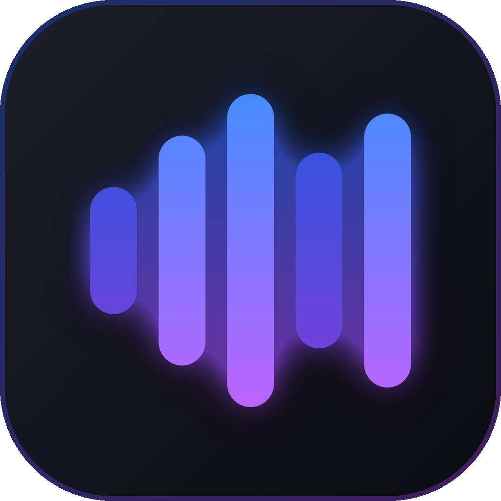

<p align="center">
  
</p>

<h1 align="center">MyTube</h1>

<p align="center"><strong>One player for YouTube Music and the music on your computer.</strong></p>

<p align="center">YouTube Music and local music player for Windows. YouTube Music works with no account. One search, one queue, mixed playlists, synced lyrics and themes.</p>

<p align="center"><sub>MyTube is a fork of <a href="https://github.com/fzn0x/mixmusic">MixMusic</a> by fzn0x and its contributors, used under the MIT license.</sub></p>

<p align="center">
  <a href="https://github.com/bigdaddy284/mymusic/actions/workflows/ci.yml"></a>
  <a href="https://github.com/bigdaddy284/mymusic/actions/workflows/pages.yml"></a>
  <a href="https://github.com/bigdaddy284/mymusic/releases/latest"></a>
  <a href="https://github.com/bigdaddy284/mymusic/releases"></a>
  <a href="https://pkg.go.dev/github.com/bigdaddy284/mymusic"></a>
  <a href="go.mod"></a>
  
  <a href="#license"></a>
</p>

<p align="center">
  <a href="https://bigdaddy284.github.io/mymusic/">Website</a> ·
  <a href="https://github.com/bigdaddy284/mymusic/releases/latest">Download</a> ·
  <a href="https://bigdaddy284.github.io/mymusic/docs/">Docs</a> ·
  <a href="CHANGELOG.md">Changelog</a>
</p>

<p align="center">
  
</p>

## Why MyTube

If your music is split between YouTube Music and files on your computer,
you usually need two apps, with two searches, two queues and two
libraries. MyTube puts both in one player:

- **One search.** It looks through YouTube Music and your own music at
  once, and marks each result with where it comes from.
- **One queue and one library.** A file on your computer can play right
  after a YouTube Music track, and a playlist can hold both.
- **No account needed.** YouTube Music plays as soon as you open the app.
  Sign in only if you want your own library.
- **A small program.** MyTube is one Go program that draws its own
  windows on the GPU. There is no browser inside it to download or keep in
  memory.
- **Yours to change.** Four layouts and fourteen themes come with it, you
  can add themes of your own, and any command can have a key
  of your own.
- **Private.** MyTube has no account, server, analytics or telemetry of
  its own.
- **Free and open source,** under the MIT license or the GPL 3.0.

## Features

### Search and play

- **One search.** Results from YouTube Music and the music on your
  computer side by side, each marked with where it comes from. YouTube
  Music results show how many times each track was played, so the original
  stands out from covers.
- **One queue.** Mix YouTube Music and your own files, shuffle and repeat
  across them, and let a radio carry on when the queue runs out.
- **Explore.** New releases, trending songs, the charts, moods and genres,
  and related songs for what plays.
- **Synced lyrics** that follow the song, or plain text if you prefer.
- **A mini player** that stays on top of your other windows.

### Your library

- **Mixes:** playlists that hold YouTube Music tracks and your own files.
  Import a YouTube Music playlist into a mix, and search and sort inside
  any of them.
- **Liked songs** from YouTube Music and your computer in one list.
- **History and listening stats,** day by day.
- **Your accounts.** Sign in to YouTube Music on Google's own page for your
  home feed, liked songs, playlists, albums and artists, as your account or
  one of its brand channels. Likes, saved albums and playlists, and
  followed artists reach YouTube Music too. What you play joins your YouTube Music history, which its
  recommendations come from.

### Sound

- Crossfade, even loudness and volume levelling.
- A ten-band equalizer with presets.
- A visualizer.
- An offline cache of the tracks you played.

### On your desktop

- Media keys and Windows' media controls.
- Global shortcuts of your own to play, pause, skip, change the volume,
  mute, like or dislike what plays or show MyTube, whichever window is
  in front.
- The player's buttons on the taskbar thumbnail.
- Tray controls, notifications of new tracks, and start at login.
- `mytube://` links.
- **Last.fm:** every track you hear joins your profile, and scrobbles made
  offline are sent once you are back online.

### Make it yours

- **Layouts.** Blend, the default, has rounded shapes and springy motion
  on dense rows of big covers. Expressive, after Material 3 Expressive, is
  playful, with tonal fills, pill buttons and a floating player bar. Crate
  is restrained, so that the covers do the work, and Tiles is MyTube's
  first look, with flat tiles and giant lowercase words.
- **Themes.** Fourteen built in, each in any layout, with effects you can
  tune, one theme for light mode and one for dark mode, and an accent
  color of your own or taken from the artwork that plays. Material and
  Material Dark make every color of the cover's.
- **Keyboard first.** Shortcuts for everything common, a key of your own for
  any command, keys that control the music
  from any app, and a command palette (<kbd>Ctrl</kbd> <kbd>K</kbd>) for
  the rest.
- **A settings file.** Your settings are `settings.json` in your data folder
  (`%AppData%\MyTube`), which you can keep with your dotfiles. Save it while MyTube runs, and it applies at once; Settings ›
  Desktop › Settings file opens it.

## A look around

<p align="center">
  
</p>

<p align="center"><sub><b>Listen.</b> In the middle, now playing アイドル by YOASOBI: each line lights up as it's sung, with romaji and a translation under it. On the left, an album; on the right, a podcast you follow.</sub></p>

<p align="center">
  
</p>

<p align="center"><sub><b>Make it yours.</b> In the middle, the four layouts: Blend, the default, Expressive, Crate and Tiles, under the themes. On the left, a Material theme that takes its colours from the cover that plays. On the right, community themes in the marketplace.</sub></p>

## Install

MyTube runs on Windows 10 and 11. Download it from the
[latest release](https://github.com/bigdaddy284/mymusic/releases/latest):

| Windows | Download |
|---|---|
| 10 and 11 (x64, Arm), installer | [`mytube-<version>-windows-<arch>-setup.exe`](https://github.com/bigdaddy284/mymusic/releases/latest) |
| Portable, no installation | [`mytube-<version>-windows-<arch>-portable.zip`](https://github.com/bigdaddy284/mymusic/releases/latest) |

`<arch>` is `amd64` for x64 and `arm64` for Arm. Each release lists
`SHA256SUMS` to check the downloads with. You don't need the files named
`update-…`, `….delta` or `-windows-<arch>.tar.gz`.

MyTube doesn't update itself: download a new release when you want it. For
the portable zip, unpack it anywhere and open `MyTube.exe`.

### The first launch

- The installer isn't signed yet, so SmartScreen may warn about it:
  choose More info, then Run anyway.
- Signing in to YouTube Music needs the
  WebView2 Runtime, which Windows 11 includes. On Windows 10, install it
  from [Microsoft](https://developer.microsoft.com/microsoft-edge/webview2/).
- MyTube finds the audio of most YouTube Music tracks itself. For the
  rest, such as tracks made for children, it uses
  [yt-dlp](https://github.com/yt-dlp/yt-dlp), which it installs for you
  from Settings › Playback and keeps up to date. yt-dlp needs a JavaScript
  runtime: [Deno](https://deno.com), Node.js, Bun or QuickJS.

### Accounts (all optional)

- **YouTube Music:** choose Sign in to YouTube Music in Settings › Accounts
  and sign in to Google in the window that opens. What you type goes to
  Google only. MyTube keeps the session encrypted, with a key in
  Windows' Credential Manager. Where that window can't open, or
  Google refuses it, import the session of a browser you signed in with
  (MyTube reads it with its yt-dlp, and keeps YouTube's cookies alone),
  or paste the Cookie header of a signed-in music.youtube.com tab.
- **Last.fm:** create an API account at
  [last.fm/api/account/create](https://www.last.fm/api/account/create)
  (any name, no callback URL), paste its API key and shared secret in
  Settings › Accounts, and approve MyTube in your browser.

Something not working? [docs/troubleshooting.md](docs/troubleshooting.md)
covers the common problems and the known issues.

## Build from source

You need [Go](https://go.dev/dl/) 1.27.3 or later, [Bun](https://bun.sh)
1.2 or later, which runs MyGo's command line, and Git. MyGo needs no C
compiler, so Linux can cross-compile the Windows app too, as releases do.

```powershell
winget install GoLang.Go
winget install Oven-sh.Bun
winget install Git.Git
```

Open a new terminal, then:

```powershell
git clone https://github.com/bigdaddy284/mymusic
cd mytube
bun install
bun run dev
```

Signing in to YouTube Music needs the WebView2 Runtime, which Windows 11
includes. On Windows 10, install it from
[Microsoft](https://developer.microsoft.com/microsoft-edge/webview2/).

### Nix

With [Nix](https://nixos.org) on Linux, `nix develop` gives you the tools
releases are built with, at the versions `flake.lock` pins: Go, Bun, NSIS,
osslsigncode, GoReleaser and Zola.

### Develop

`bun run dev` builds the app, starts it, and rebuilds it as you edit. Its
data stays apart from an installed MyTube, under the name
`MyTube Dev`.

```sh
go test ./...                  # the app's tests
bun run build                  # the installer and the app, in build/
bun run build -- -platform windows/amd64,windows/arm64
```

In the Nix shell, `.github/scripts/build.sh windows/amd64,windows/arm64`
builds the downloads as releases do, and `.github/scripts/package.sh`
makes the portable zips.

The [website](https://bigdaddy284.github.io/mymusic/) is in `site/`, built with
[Zola](https://www.getzola.org), and the guides in `docs/` are its
`/docs/` pages. `go run ./tools/sitedocs && zola --root site serve`
previews it. Releases are built in the Nix shell and published by
[GoReleaser](https://goreleaser.com) (`.goreleaser.yaml`).

[docs/architecture](docs/architecture/README.md) explains how the parts fit
together.

### Layout

The app is the root package, with the packages of `internal/` under it. The
packages outside `internal/` are for anyone to import, and documented on
[pkg.go.dev](https://pkg.go.dev/github.com/bigdaddy284/mymusic).

```
*.go                 the app and its windows: the pages, the player bar, the
                     mini player, the tray, media keys, deep links
fonts/               the typefaces the windows draw with
internal/app         the services the windows call, and the desktop integration
internal/player      the queue, played by the audio engine or on a cast device
internal/audio       MyTube's audio engine, and the system's audio output
internal/youtube     YouTube Music's catalog, and your account there
internal/stream      audio streams, from YouTube or yt-dlp, opened for the engine
internal/match       the songs of YouTube Music's videos
internal/romaji      Japanese lyrics in romaji, kanji read by kagome
internal/library     liked and disliked songs, mixes, history and stats
internal/lastfm      scrobbling to Last.fm
internal/diag        the log, without secrets, and the reports of crashes
internal/addons      themes
builtin/themes       the themes MyTube ships with
public/              the page of the picture of music videos
examples/            example themes
```

The packages you can import:

```
opus/                an Opus decoder in pure Go, a port of libopus's
aac/                 an AAC-LC decoder in pure Go
ac3/                 an AC-3 and E-AC-3 decoder in pure Go, written from ATSC A/52
webm/                the audio of WebM files: packets, times and seeking
mp4/                 the audio of MP4 files: packets, times and seeking
resample/            sample rate conversion, with Kaiser-windowed sincs
lyrics/              synced lyrics from Unison and LRCLIB, and translations
brand/               MyTube's logo, for code that draws it
```

## Themes

Themes load from your themes folder, and you can make your
own. [docs/addons.md](docs/addons.md) tells how to add one.

### Make a theme

A theme is a `theme.json` file that sets colors, fonts and corners, which
show in the layout the user chose.
[docs/themes.md](docs/themes.md) lists every token and shows a complete
theme. To try yours, put its folder in the themes folder (Settings ›
Appearance › open themes folder) and choose it in Settings › Appearance.

## Privacy

MyTube has no account, server, analytics or telemetry of its own. It
talks to:

- **YouTube and Google:** YouTube Music's catalog, its streams and how loud
  each track is, asked for while signed out, and the artwork; some streams
  through yt-dlp. Signed in, your library there, and, unless you turn it
  off in Settings › Accounts, the tracks you play, which join your YouTube
  Music history.
- **Unison:** the video ID of the track that plays, or, without one, its
  title, artists, album and length, to find its lyrics. Only while you
  turn on translate, or romanize, beside the lyrics, the lyrics of the
  track that plays, with its video ID, which Unison has Google translate.
- **LRCLIB:** the title, artists, album and length of the track that plays,
  to find its lyrics.
- **GitHub:** a check for a new version at start and every few hours,
  which you can turn off in Settings › About; the downloads of yt-dlp; and, the first time
  you turn on romaji beside Japanese lyrics, the dictionary of the
  readings of kanji (11.7 MB). Romaji is made on your computer: the
  lyrics aren't sent.
- **Last.fm,** once you connect it: what you play.

What it keeps on your computer:

- Your settings and library (liked and disliked songs, mixes, history and
  recent searches), in the folder Settings › About names.
- The tracks you played, in the cache, as much as you allow in Settings ›
  Playback, and how loud YouTube measured them.
- The covers you saw, up to 256 MB.
- The translations of lyrics you turned on, by track and language, and
  the dictionary romaji reads kanji with, once you turned it on.
- Your sign-ins, the YouTube Music session included, in Windows'
  Credential Manager. When it can't keep one, it goes in a file encrypted
  for your Windows account.
- The log, without your sign-ins.

The library's history page clears what you played, Settings › Playback
clears the cache and the covers, and signing out of a service deletes its
sign-in.

The visualizer analyzes the audio MyTube plays in memory, and never
records or sends it.

## Credits

MyTube is built on these projects:

- **[MyGo](https://github.com/egoist/mygo)**, the desktop framework MyTube
  is built with. MyTube uses MyGo's native UI: MyGo draws every window
  itself, in Go, without a webview, from the pages and the player bar to the
  mini player. Its command line packages the app, with its installers.
- **[Go](https://go.dev)**, the language of the app, with
  [purego](https://github.com/ebitengine/purego), which calls the system's
  libraries without cgo, and [golang.org/x/image](https://pkg.go.dev/golang.org/x/image)
  and [golang.org/x/text](https://pkg.go.dev/golang.org/x/text).
- **[Sobek](https://github.com/grafana/sobek)**, the JavaScript engine
  the tests run the video page's script in.
- **[Nix](https://nixos.org)**, which pins the tools releases are built
  with.
- **[GoReleaser](https://goreleaser.com)**, which publishes the releases.
- **[Bun](https://bun.sh)**, which runs the build.
- **[Zola](https://www.getzola.org)**, which builds the website.
- **[NSIS](https://nsis.sourceforge.io)**, which makes the Windows
  installers.
- **[yt-dlp](https://github.com/yt-dlp/yt-dlp)**, which finds the audio of
  the tracks MyTube can't find itself.
- **[Unison](https://unison.boidu.dev)**, the open, crowdsourced database of
  lyrics, under the ODbL, and **[LRCLIB](https://lrclib.net)**, the open
  database of synced lyrics.
- **[kagome](https://github.com/ikawaha/kagome)**, the Japanese
  morphological analyser that reads the kanji of lyrics for their romaji,
  with the IPA dictionary of
  [kagome-dict](https://github.com/ikawaha/kagome-dict), made from
  mecab-ipadic, which MyTube downloads the first time romaji is turned
  on.
- **[libopus](https://opus-codec.org)**, whose decoder the Opus decoder is a
  port of, and **[SharpJaad](https://github.com/jimm98y/SharpJaad)**, the C#
  port of [JAAD](https://sourceforge.net/projects/jaadec/) the AAC decoder
  derives from.
- **[FFmpeg](https://ffmpeg.org)**, which the decoders' tests compare with.
- **[Selawik](https://github.com/microsoft/Selawik)**,
  **[Quicksand](https://github.com/andrew-paglinawan/QuicksandFamily)**,
  **[Roboto Flex](https://github.com/googlefonts/roboto-flex)** and
  **[Archivo](https://github.com/Omnibus-Type/Archivo)**, the typefaces of
  the windows.
- **[Material Color Utilities](https://github.com/material-foundation/material-color-utilities)**,
  whose HCT color science the Material themes' colors are a port of.
- **[Kevin MacLeod](https://incompetech.com)**, whose music, under
  [CC BY 4.0](https://creativecommons.org/licenses/by/4.0/), plays on the
  website.

## Contributing

Fixes, features, themes and bug reports are all welcome.

- **Report a problem** by [opening an issue](https://github.com/bigdaddy284/mymusic/issues/new).
- **Send a change** as a pull request. [CONTRIBUTING.md](CONTRIBUTING.md)
  explains the checks to run, the commit style, and the changelog entry
  that a change people will notice needs.

[CONTRIBUTORS.md](CONTRIBUTORS.md) thanks the people whose code, ideas and
reports shaped MyTube.

## License

MyTube is dual-licensed: use it under the [MIT license](LICENSE-MIT) or
the [GNU General Public License, version 3](LICENSE-GPL), whichever you
prefer. Contributions are accepted under both. The typefaces in `fonts` are
under the SIL Open Font License: [Selawik's](fonts/OFL.txt),
[Quicksand's](fonts/quicksand-OFL.txt),
[Roboto Flex's](fonts/robotoflex-OFL.txt) and
[Archivo's](fonts/archivo-OFL.txt). The Opus decoder is a port of
libopus, under [its BSD license](opus/LICENSE.libopus), the AAC decoder
derives from SharpJaad, under [its MIT license](aac/LICENSE.sharpjaad), and
the HCT color science is a port of Material Color Utilities, under
[its Apache license](internal/hct/LICENSE.material-color-utilities).

MyTube is not affiliated with, endorsed by or sponsored by Google, and
is provided as is, without warranty: use it at your own risk. YouTube
and YouTube Music are trademarks of Google.
