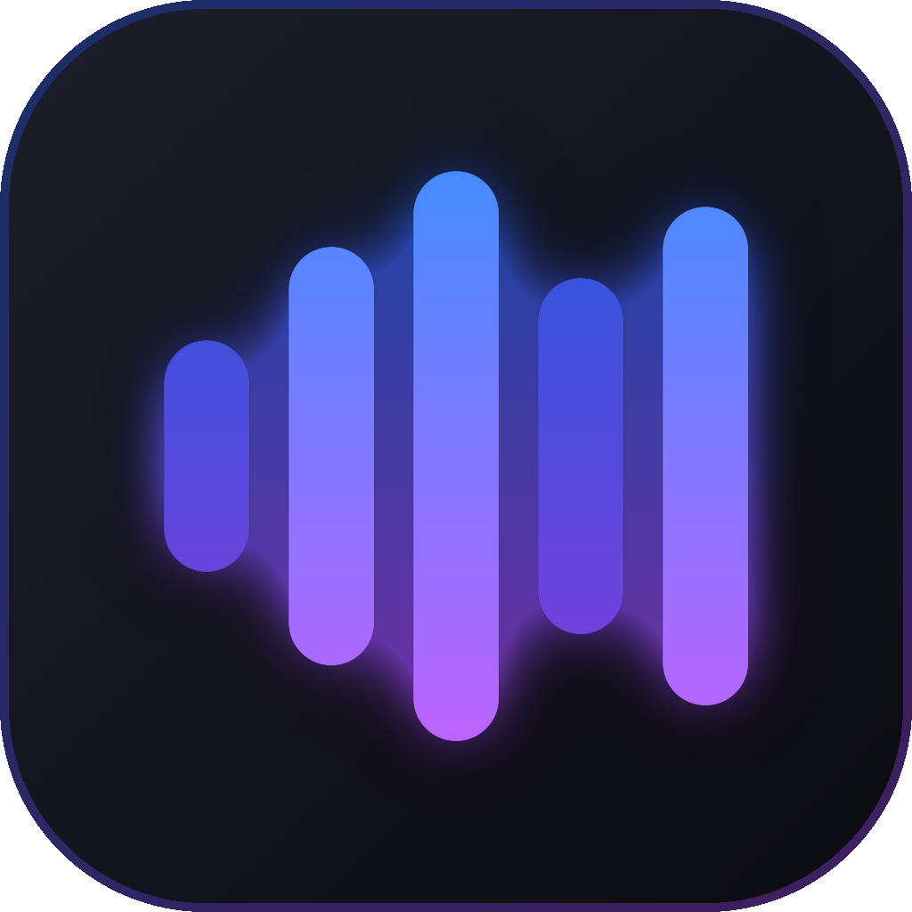

<p align="center"><a href="README.md">English</a> · <strong>简体中文</strong> · <a href="README.id.md">Bahasa Indonesia</a></p>

<p align="center">
  
</p>

<h1 align="center">MyTube</h1>

<p align="center"><strong>一个播放器，同时播放 YouTube Music 和你电脑上的音乐。</strong></p>

<p align="center">适用于 Windows 的 YouTube Music 与本地音乐播放器。YouTube Music 无需账号即可使用。统一的搜索和播放队列，还有混合歌单、同步歌词、主题和插件。</p>

<p align="center"><sub>本文译自<a href="README.md">英文 README</a>，如有出入，以最新的英文版为准。</sub></p>

<p align="center">
  <a href="https://github.com/bigdaddy284/mymusic/actions/workflows/ci.yml"></a>
  <a href="https://github.com/bigdaddy284/mymusic/actions/workflows/pages.yml"></a>
  <a href="https://github.com/bigdaddy284/mymusic/releases/latest"></a>
  <a href="https://github.com/bigdaddy284/mymusic/releases"></a>
  <a href="https://pkg.go.dev/github.com/bigdaddy284/mymusic"></a>
  <a href="go.mod"></a>
  
  <a href="#许可证"></a>
</p>

<p align="center">
  <a href="https://bigdaddy284.github.io/mymusic/">网站</a> ·
  <a href="https://github.com/bigdaddy284/mymusic/releases/latest">下载</a> ·
  <a href="https://bigdaddy284.github.io/mymusic/docs/">文档</a> ·
  <a href="CHANGELOG.md">更新日志</a>
</p>

<p align="center">
  
</p>

## 为什么选择 MyTube

如果你的音乐分散在 YouTube Music 和电脑上的文件两边，通常就得用两个应用，也就有两处搜索、两个播放队列和两个音乐库。MyTube 把它们放进同一个播放器里：

- **统一搜索**：同时搜索 YouTube Music 和你自己的音乐，并在每条结果上标明它的来源。
- **统一的播放队列和音乐库**：电脑上的文件可以紧接着 YouTube Music 的歌曲播放，一个歌单里也可以同时放两边的歌。
- **无需账号**：打开应用就能播放 YouTube Music。只有想用自己的音乐库时才需要登录。
- **程序小巧**：MyTube 是一个 Go 程序，用 GPU 自己绘制窗口。它内部不带浏览器，既不用额外下载，也不会让浏览器常驻内存。
- **随你改造**：自带十个主题，你也可以添加自己的主题和插件，任何命令都可以设置你自己的快捷键。
- **注重隐私**：MyTube 没有自己的账号体系、服务器、统计分析或遥测。
- **免费开源**：可按 MIT 许可证或 GPL 3.0 使用。

## 功能

### 搜索与播放

- **统一搜索**：YouTube Music 和你电脑上音乐的结果并排显示，每条都标明来源。YouTube Music 的结果会显示每首歌的播放次数，原版和翻唱一眼就能分清。
- **统一播放队列**：YouTube Music 的歌曲和你自己的文件可以混在一起，随机播放和循环播放对它们都生效；队列播完后，还可以让电台接着播。
- **探索**：新发行、热门歌曲、排行榜、心情与曲风，以及与正在播放的歌曲相关的歌。
- **同步歌词**：歌词跟着歌曲走；如果你更喜欢，也可以显示纯文本。
- **迷你播放器**：始终显示在其他窗口之上。

### 你的音乐库

- **混合歌单（Mixes）**：能同时收录 YouTube Music 歌曲和你自己文件的歌单。可以把 YouTube Music 的歌单导入混合歌单，也可以在任意一个混合歌单里搜索和排序。
- **喜欢的歌曲**：YouTube Music 和你电脑上你喜欢的歌汇总在同一个列表里。
- **播放历史与收听统计**：按天查看。
- **你的账号**：在 Google 自己的页面上登录 YouTube Music，就能使用你的首页推荐、喜欢的歌曲、歌单、专辑和艺人；可以用你的账号本身登录，也可以用它名下的某个品牌频道。点喜欢、收藏专辑和歌单、关注艺人，这些操作也会同步到 YouTube Music。你播放的歌曲会进入你的 YouTube Music 播放记录，YouTube Music 的推荐就是根据这些记录来的。

### 音频

- 交叉淡入淡出、统一响度和音量均衡。
- 带预设的十段均衡器。
- 音乐可视化效果。
- 播放过的歌曲可以离线缓存。

### 桌面集成

- 支持媒体键和 Windows 的媒体控制。
- 在 Windows 上，任务栏缩略图中带有播放器按钮。
- 托盘控制、切换到新歌曲时的通知，以及开机自启。
- `mytube://` 链接。
- **Last.fm**：你听的每首歌都会记录到你的个人资料中，离线时产生的 scrobble 会在恢复联网后补发。
- **Discord**：你的个人资料上会显示正在播放的歌曲，以及它的封面和剩余时间。
- **更新**：MyTube 在启动时以及之后每隔几小时检查一次新版本，验证它的签名，在你确认后安装；你也可以选择让它自动安装。

### 个性化

- **主题**：内置十个主题，效果可以调节；浅色模式和深色模式可以各用一个主题；强调色可以自己选，也可以取自正在播放的歌曲封面。
- **插件**：通过带类型的 API 添加页面、命令、歌曲操作和小组件，并按你的主题绘制。
- **键盘优先**：常用操作都有快捷键；任何命令（包括插件的命令）都可以设置你自己的快捷键；其余操作可以用命令面板（<kbd>Ctrl</kbd> <kbd>K</kbd>）完成。
- **设置文件**：你的设置保存在数据文件夹中的 `settings.json` 里（`%AppData%\MyTube`），可以和你的 dotfiles 放在一起管理。在 MyTube 运行时保存这个文件，改动会立即生效；在 Settings › Desktop › Settings file（设置 › 桌面 › 设置文件）中可以打开它。

## 界面一览

<p align="center">
  
</p>

<p align="center"><sub><b>听歌。</b>中间是正在播放的 YOASOBI《アイドル》：每行歌词随演唱逐字亮起，下方显示罗马音和翻译。左边是一张专辑，右边是你关注的播客。</sub></p>

<p align="center">
  
</p>

<p align="center"><sub><b>个性化。</b>中间是四种布局：默认的 Blend，以及 Expressive、Crate 和 Tiles，下方是主题。左边是从正在播放的封面取色的 Material 主题。右边是市场里的社区主题。</sub></p>

## 安装

MyTube 可在 Windows 10 和 11 上运行。从[最新版本](https://github.com/bigdaddy284/mymusic/releases/latest)中下载：

| Windows | 下载 |
|---|---|
| 10 和 11（x64、Arm），安装程序 | [`mytube-<version>-windows-<arch>-setup.exe`](https://github.com/bigdaddy284/mymusic/releases/latest) |
| 便携版，无需安装 | [`mytube-<version>-windows-<arch>-portable.zip`](https://github.com/bigdaddy284/mymusic/releases/latest) |

`<arch>` 在 x64 上是 `amd64`，在 Arm 上是 `arm64`。每个版本都附有 `SHA256SUMS`，可以用来校验下载的文件。名为 `update-…`、`….delta` 或 `-windows-<arch>.tar.gz` 的文件不需要下载：它们是已安装的应用自动更新时用的。

安装程序和便携版 zip 会自行更新。便携版 zip 解压到任意位置，打开 `MyTube.exe` 即可。

### 首次启动

- 安装程序还没有签名，所以 SmartScreen 可能会发出警告：选择 More info（更多信息），然后选择 Run anyway（仍要运行）。
- 登录 YouTube Music 需要 WebView2 Runtime，Windows 11 已自带。Windows 10 上请从 [Microsoft](https://developer.microsoft.com/microsoft-edge/webview2/) 安装。
- 大多数 YouTube Music 歌曲的音频，MyTube 都能自己找到。其余的歌曲（比如面向儿童的内容），它会使用 [yt-dlp](https://github.com/yt-dlp/yt-dlp)：你可以在 Settings › Playback（设置 › 播放）中让 MyTube 替你安装 yt-dlp，之后它也会让 yt-dlp 保持最新。yt-dlp 需要一个 JavaScript 运行时：[Deno](https://deno.com)、Node.js、Bun 或 QuickJS。

### 账号（均为可选）

- **YouTube Music**：在 Settings › Accounts（设置 › 账号）中选择 Sign in to YouTube Music（登录 YouTube Music），然后在弹出的窗口中登录 Google。你输入的内容只会发送给 Google。MyTube 会加密保存登录会话，密钥存放在 Windows 的凭据管理器（Credential Manager）中。
- **Last.fm**：在 [last.fm/api/account/create](https://www.last.fm/api/account/create) 创建一个 API 账号（名称随意，不用填回调 URL），把它的 API key 和 shared secret 粘贴到 Settings › Accounts 中，然后在浏览器中授权 MyTube。
- **Discord**：Discord 应用运行时，你的个人资料上会显示你正在听的内容。可以在 Settings › Desktop（设置 › 桌面）中关闭。

遇到问题？[docs/troubleshooting.md](docs/troubleshooting.md) 列出了常见问题和已知问题。

## 从源码构建

你需要 [Go](https://go.dev/dl/) 1.27.3 或更高版本、[Bun](https://bun.sh) 1.2 或更高版本（用来运行 MyGo 的命令行工具），以及 Git。MyGo 不需要 C 编译器，所以也可以像正式发布那样，在 Linux 上交叉编译 Windows 版。

```powershell
winget install GoLang.Go
winget install Oven-sh.Bun
winget install Git.Git
```

打开一个新的终端，然后运行：

```powershell
git clone https://github.com/bigdaddy284/mymusic
cd mytube
bun install
bun run dev
```

登录 YouTube Music 需要 WebView2 Runtime，Windows 11 已自带。Windows 10 上请从 [Microsoft](https://developer.microsoft.com/microsoft-edge/webview2/) 安装。

### Nix

在 Linux 上使用 [Nix](https://nixos.org) 时，`nix develop` 会提供构建正式版本所用的工具，版本由 `flake.lock` 锁定：Go、Bun、NSIS、osslsigncode、GoReleaser 和 Zola。

### 开发

`bun run dev` 会构建并启动应用，并在你修改代码时重新构建。它的数据以 `MyTube Dev` 的名称单独存放，与已安装的 MyTube 互不干扰。

```sh
bun run build:plugins          # the plugins' JavaScript, from their TypeScript
go test ./...                  # the app's tests
bun run typecheck              # the plugin SDK and the example plugins
bun run build                  # the installer and the app, in build/
bun run build -- -platform windows/amd64,windows/arm64
```

在 Nix shell 中，请像正式发布那样，用 `.github/scripts/build.sh windows/amd64,windows/arm64` 构建下载包，并用 `.github/scripts/package.sh` 制作便携版 zip。

[网站](https://bigdaddy284.github.io/mymusic/)的源码在 `site/` 中，用 [Zola](https://www.getzola.org) 构建，`docs/` 中的指南就是网站的 `/docs/` 页面。运行 `go run ./tools/sitedocs && zola --root site serve` 可以预览网站。正式版本在 Nix shell 中构建，由 [GoReleaser](https://goreleaser.com) 发布（`.goreleaser.yaml`）。

[docs/architecture](docs/architecture/README.md) 介绍了各个部分是如何配合工作的。

### 目录结构

应用本身是根包，其下是 `internal/` 中的各个包。`internal/` 之外的包任何人都可以导入，文档见 [pkg.go.dev](https://pkg.go.dev/github.com/bigdaddy284/mymusic)。

```
*.go                 the app and its windows: the pages, the player bar, the
                     mini player, the tray, media keys, deep links
fonts/               the typefaces the windows draw with
internal/app         the services the windows call, and the desktop integration
internal/player      the queue, played by the audio engine or on a cast device
internal/audio       MyTube's audio engine, and the system's audio output
internal/plugins     plugins, each in a JavaScript engine of its own
internal/youtube     YouTube Music's catalog, and your account there
internal/stream      audio streams, from YouTube or yt-dlp, opened for the engine
internal/match       the songs of YouTube Music's videos
internal/library     liked songs, mixes, history and stats
internal/lastfm      scrobbling to Last.fm
internal/discord     what plays, on your Discord profile
internal/diag        the log, without secrets, and the reports of crashes
internal/addons      themes and plugins
builtin/themes       the themes MyTube ships with
public/              the page of the picture of music videos
sdk/                 the types of the plugin API
examples/            example themes and plugins
```

可以导入的包：

```
opus/                an Opus decoder in pure Go, a port of libopus's
aac/                 an AAC-LC decoder in pure Go
webm/                the audio of WebM files: packets, times and seeking
mp4/                 the audio of MP4 files: packets, times and seeking
resample/            sample rate conversion, with Kaiser-windowed sincs
lyrics/              synced lyrics from LRCLIB, and the LRC format
brand/               MyTube's logo, for code that draws it
```

## 主题和插件

主题和插件从你的附加组件文件夹加载，你也可以自己制作。[docs/addons.md](docs/addons.md) 介绍了如何添加。

### 制作主题

主题就是一个 `theme.json` 文件，用来设置颜色、字体和圆角。[docs/themes.md](docs/themes.md) 列出了所有 token，并给出了一个完整的主题。想试试你的主题，就把它的文件夹放进主题文件夹（用 Settings › Appearance › open themes folder 打开，即“设置 › 外观 › 打开主题文件夹”），然后在 Settings › Appearance 中选择它。

### 制作插件

插件是用 TypeScript 或 JavaScript 编写的小模块，可以添加页面、命令、歌曲操作和小组件。[docs/plugins.md](docs/plugins.md) 是 API 的文档，还附有供编辑器使用的[类型定义](sdk/index.d.ts)。`examples/` 里的 [sleep timer](examples/plugins/sleep-timer) 和 [spectrum](examples/plugins/spectrum) 都是能直接运行的示例。

## 隐私

MyTube 没有自己的账号体系、服务器、统计分析或遥测。它会与以下服务通信：

- **YouTube 和 Google**：YouTube Music 的曲库、音频流和每首歌的响度（这些都在未登录状态下请求），以及封面图片；部分音频流通过 yt-dlp 获取。登录后，还有你在那里的音乐库；另外，除非你在 Settings › Accounts（设置 › 账号）中关闭，你播放的歌曲也会发送过去，进入你的 YouTube Music 播放记录。
- **LRCLIB**：正在播放的歌曲的标题、艺人、专辑和时长，用来查找歌词。
- **GitHub**：启动时以及之后每隔几小时检查一次新版本，可以在 Settings › About（设置 › 关于）中关闭；以及下载 yt-dlp。
- **Last.fm**（连接之后）：你播放的内容。
- **Discord**（除非你关闭）：正在播放的内容，发送给你电脑上的 Discord 应用，由它显示在你的个人资料上。

它在你电脑上保存的内容：

- 你的设置和音乐库（喜欢的歌曲、混合歌单、播放历史和最近的搜索），保存在 Settings › About 中显示的文件夹里。
- 你播放过的歌曲，存放在缓存中，大小以你在 Settings › Playback（设置 › 播放）中允许的为限；以及 YouTube 测得的这些歌曲的响度。
- 你看过的封面，最多 256 MB。
- 你的登录信息（包括 YouTube Music 会话），保存在凭据管理器（Credential Manager）中。如果凭据管理器存不下某条登录信息，它会存进一个针对你的 Windows 账户加密的文件。
- 日志，其中不含你的登录信息。

在音乐库的播放历史页面可以清除播放记录，在 Settings › Playback 中可以清除缓存和封面，退出某个服务的登录会删除它的登录信息。

可视化效果只在内存中分析 MyTube 播放的音频，从不录制或发送。

## 致谢

MyTube 基于以下项目构建：

- **[MyGo](https://github.com/egoist/mygo)**：MyTube 所用的桌面框架。MyTube 使用 MyGo 的原生 UI：从各个页面、播放栏到迷你播放器，每个窗口都由 MyGo 用 Go 自己绘制，不使用 webview。它的命令行工具负责打包应用，包括安装程序，以及应用自我更新所用的签名更新包。
- **[Go](https://go.dev)**：应用使用的语言；以及 [purego](https://github.com/ebitengine/purego)（无需 cgo 即可调用系统库）、[golang.org/x/image](https://pkg.go.dev/golang.org/x/image) 和 [golang.org/x/text](https://pkg.go.dev/golang.org/x/text)。
- **[Sobek](https://github.com/grafana/sobek)**：每个插件运行所在的 JavaScript 引擎。
- **[Nix](https://nixos.org)**：锁定构建正式版本所用的工具。
- **[GoReleaser](https://goreleaser.com)**：发布正式版本。
- **[Bun](https://bun.sh)**：运行构建流程。**[TypeScript](https://www.typescriptlang.org)**：编译插件，并检查插件 SDK 的类型。
- **[Zola](https://www.getzola.org)**：构建网站。
- **[NSIS](https://nsis.sourceforge.io)**：制作 Windows 安装程序。
- **[yt-dlp](https://github.com/yt-dlp/yt-dlp)**：为 MyTube 自己找不到音频的歌曲找到音频。
- **[LRCLIB](https://lrclib.net)**：开放的同步歌词数据库。
- **[libopus](https://opus-codec.org)**：MyTube 的 Opus 解码器移植自它的解码器。**[SharpJaad](https://github.com/jimm98y/SharpJaad)**：[JAAD](https://sourceforge.net/projects/jaadec/) 的 C# 移植版，MyTube 的 AAC 解码器就源自它。
- **[FFmpeg](https://ffmpeg.org)**：解码器的测试以它作为对照。
- **[Selawik](https://github.com/microsoft/Selawik)** 和 **[Quicksand](https://github.com/andrew-paglinawan/QuicksandFamily)**：窗口中使用的字体。
- **[Kevin MacLeod](https://incompetech.com)**：网站中播放的是他的音乐，采用 [CC BY 4.0](https://creativecommons.org/licenses/by/4.0/) 许可。

## 参与贡献

欢迎提交修复、新功能、主题、插件和 bug 报告。

- **报告问题**：在 Settings › About › report a problem（设置 › 关于 › 报告问题）中报告。它会新建一个 GitHub issue，并自动填好你的版本、系统、主题和插件。你也可以自己[新建 issue](https://github.com/bigdaddy284/mymusic/issues/new)。
- **提交改动**：以 pull request 的形式提交。[CONTRIBUTING.md](CONTRIBUTING.md) 说明了需要运行的检查、提交信息的风格，以及用户能感知到的改动需要附带的更新日志条目。

[CONTRIBUTORS.md](CONTRIBUTORS.md) 列出了以代码、想法和问题报告帮助塑造 MyTube 的人，感谢他们。

## 许可证

MyTube 采用双重许可：你可以任选 [MIT 许可证](LICENSE-MIT)或 [GNU General Public License, version 3](LICENSE-GPL) 来使用它。贡献同时以这两种许可证接受。`fonts` 中的字体采用 SIL Open Font License：[Selawik 的许可证](fonts/OFL.txt)和 [Quicksand 的许可证](fonts/quicksand-OFL.txt)。Opus 解码器移植自 libopus，采用[它的 BSD 许可证](opus/LICENSE.libopus)；AAC 解码器源自 SharpJaad，采用[它的 MIT 许可证](aac/LICENSE.sharpjaad)。

MyTube 与 Google 没有任何关联，也未获得其认可或赞助。它通过 YouTube Music 自己的接口，播放它向用户提供的内容；请在其条款允许的范围内使用。YouTube Music 是其所有者的商标。
